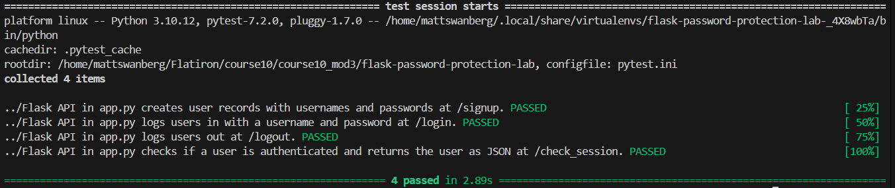

# Lab: Password Protection

## Overview

A full-stack authentication application built using Flask, Flask-RESTful, SQLAlchemy, Flask-Bcrypt, Marshmallow, and React

This project demonstrates secure user authentication through password hashing, session management, and RESTful API endpoints

Users can register an account, log in with their credentials, maintain an authenticated session, and securely log out

The Flask backend handles authentication and database operations, while the provided React frontend manages the user interface

## Technologies Used

### Backend
- Python
- Flask
- Flask-RESTful
- Flask-SQLAlchemy
- Flask-Bcrypt
- Flask-Migrate
- Marshmallow
- SQLite

### Frontend
- React
- JavaScript
- HTML
- CSS

### Development and Testing
- Pipenv
- Pytest
- Git and GitHub

## Features

### Secure Password Hashing
- Passwords are hashed using Flask-Bcrypt before being stored in the database
- Plaintext passwords are never stored in the database
- Direct access to the public `password_hash` property raises an exception
- Passwords are verified against their stored hashes during login

### User Registration
- Creates new users using a username and password
- Automatically hashes passwords before database insertion
- Automatically authenticates users after successful registration
- Returns serialized user information without exposing password hashes

### User Login
- Authenticates existing users using their username and password
- Uses Bcrypt to verify supplied credentials
- Stores authenticated user IDs in Flask sessions
- Rejects invalid credentials with HTTP 401

### Session Management
- Maintains user authentication using Flask sessions
- Verifies whether a user has an active authenticated session
- Returns authenticated user information when a valid session exists
- Allows users to log out by clearing their session ID

## Project Structure

The primary application files include:

```text
flask-password-protection-lab/
├── client/                 # React frontend
├── server/
│   ├── app.py              # Flask API resources and routes
│   ├── config.py           # Flask application and extension configuration
│   ├── models.py           # User model and Marshmallow schema
│   └── migrations/         # Database migration files
├── testing/                # Automated test suite
├── Pipfile                 # Python dependencies
├── Pipfile.lock            # Locked Python dependencies
├── package.json            # Frontend dependency configuration, if present
├── test_suite.png          # Screenshot of successful tests
└── README.md               # Project documentation
```

## Installation and Setup

### Prerequisites

Ensure the following are installed:

- Python
- Pipenv
- Node.js
- npm
- Git

### 1. Clone the Repository

```bash
git clone https://github.com/Matt20Swanberg/flask-password-protection-lab
cd flask-password-protection-lab
```

### 2. Install Python Dependencies

From the project root:

```bash
pipenv install
pipenv shell
```

### 3. Install Frontend Dependencies

```bash
npm install --prefix client
```

### 4. Apply Database Migrations

Navigate to the server directory:

```bash
cd server
flask db upgrade head
```

### 5. Start the Flask Backend

From the `server` directory:

```bash
python app.py
```

The Flask development server runs at:

```text
http://127.0.0.1:5555
```

### 6. Start the React Frontend

Open a separate terminal and navigate to the project root

Run:

```bash
npm start --prefix client
```

The React frontend provides the signup, login, and authenticated user interfaces

## Database Model

### User Model

The `User` model represents registered users and stores authentication information

| Field | Type | Description |
|-------|------|-------------|
| `id` | Integer | Primary key |
| `username` | String | User's username |
| `_password_hash` | String | Bcrypt-hashed password |

### Password Protection

The model implements three password-related methods:

**`password_hash` getter**
- Prevents direct access to the password hash through the public property
- Raises an exception when accessed

**`password_hash` setter**
- Generates a secure password hash using Bcrypt
- Converts the generated hash into a UTF-8 string
- Stores the resulting hash in `_password_hash`

**`authenticate(password)`**
- Compares a supplied password against the stored hash
- Returns `True` when the password matches
- Returns `False` when the password is incorrect

### User Serialization

The `UserSchema` Marshmallow schema serializes user objects into JSON

Only the following fields are included:

- `id`
- `username`

Password hashes are excluded from serialized API responses

## API Endpoints

### POST /signup

Creates a new user and automatically establishes an authenticated session

**Request Body**

```json
{
  "username": "ash",
  "password": "pikachu"
}
```

**Successful Response — 201 Created**

```json
{
  "id": 1,
  "username": "ash"
}
```

**Functionality**
- Retrieves the username and password from the request
- Creates a new `User` instance
- Hashes the password using the model's password setter
- Saves the user to the database
- Stores the new user's ID in the Flask session
- Returns serialized user data

### POST /login

Authenticates an existing user using their username and password

**Request Body**

```json
{
  "username": "ash",
  "password": "pikachu"
}
```

**Successful Response — 200 OK**

```json
{
  "id": 1,
  "username": "ash"
}
```

**Failed Response — 401 Unauthorized**

```json
{
  "message": "Invalid username or password"
}
```

**Functionality**
- Retrieves the supplied login credentials
- Queries the database for the requested username
- Verifies the password using `authenticate()`
- Stores the user's ID in the session after successful authentication
- Rejects invalid credentials

### GET /check_session

Checks whether the current user has an active authenticated session

**Successful Response — 200 OK**

```json
{
  "id": 1,
  "username": "ash"
}
```

**Unauthenticated Response — 204 No Content**

Returns an empty response body

**Functionality**
- Retrieves the user ID from the current Flask session
- Queries the database for the associated user
- Confirms that the user exists
- Returns serialized user information when authenticated
- Returns HTTP 204 when no valid authenticated user exists

### DELETE /logout

Logs out the currently authenticated user

**Successful Response — 204 No Content**

Returns an empty response body

**Functionality**
- Clears the authenticated user's ID from the Flask session
- Returns HTTP 204 after logout

### DELETE /clear

Clears stored session information

**Successful Response — 204 No Content**

Returns an empty response body

**Functionality**
- Resets the `page_views` session value
- Clears the authenticated user's ID
- Returns HTTP 204

## Authentication Workflow

### Registration

1. The user submits a username and password through the signup form
2. Flask retrieves the submitted credentials
3. A new `User` instance is created
4. Bcrypt generates a secure hash of the supplied password
5. The user is saved to the database
6. The user's database ID is stored in the Flask session
7. The backend returns the serialized user with HTTP 201

### Login

1. The user submits their username and password
2. Flask searches the database for the matching username
3. The `authenticate()` method verifies the supplied password
4. Successful authentication stores the user's ID in the session
5. The backend returns the serialized user with HTTP 200
6. Invalid credentials return HTTP 401

### Session Verification

1. The frontend requests `/check_session`
2. Flask retrieves the user ID from the session
3. The database is queried for the associated user
4. A valid user is returned with HTTP 200
5. An invalid or missing session returns HTTP 204

### Logout

1. The frontend sends a DELETE request to `/logout`
2. Flask clears the authenticated user ID from the session
3. The backend returns HTTP 204
4. Subsequent session checks no longer identify an authenticated user

## Testing

Automated tests are provided to verify the authentication endpoints

### Running the Tests

From the `server` directory, run:

```bash
pytest -v
```

To stop testing after the first failure:

```bash
pytest -x -v
```

### Test Coverage

The provided test suite verifies the following functionality:

| Test | Description | Result |
|------|-------------|--------|
| Signup | Creates a user with a hashed password | Passed |
| Login | Authenticates a user using valid credentials | Passed |
| Logout | Clears the authenticated user's session | Passed |
| Check Session | Retrieves the authenticated user from the session | Passed |

### Final Test Results

All four automated tests passed successfully

```text
4 passed
```

## Screenshots

### Automated Test Suite

The following screenshot demonstrates the successful execution of the provided Pytest test suite



## Security Considerations

This project demonstrates several important authentication practices:

- Passwords are hashed before being stored in the database
- Plaintext passwords are not persisted
- Password verification is performed using Bcrypt
- Password hashes are excluded from API responses
- Authentication sessions store user IDs rather than passwords
- Login requests with invalid credentials are rejected
- Logout clears the authenticated user's session ID
- Session verification confirms that the referenced user exists in the database

### Additional Considerations

This application is intended for educational and local development purposes

A production deployment would require additional security measures, including secure session cookie configuration, HTTPS, CSRF protection where applicable, input validation, and login rate limiting

## Learning Objectives

This lab demonstrates how to:

- Implement secure password hashing using Flask-Bcrypt
- Protect password-related model properties
- Authenticate users using hashed passwords
- Create RESTful signup and login endpoints
- Manage authenticated users through Flask sessions
- Implement session verification and logout functionality
- Serialize SQLAlchemy models using Marshmallow
- Test authentication endpoints using Pytest


## Author

Created by Matthew Swanberg as part of Course 10 Module 3 (Lab: Password Protection)